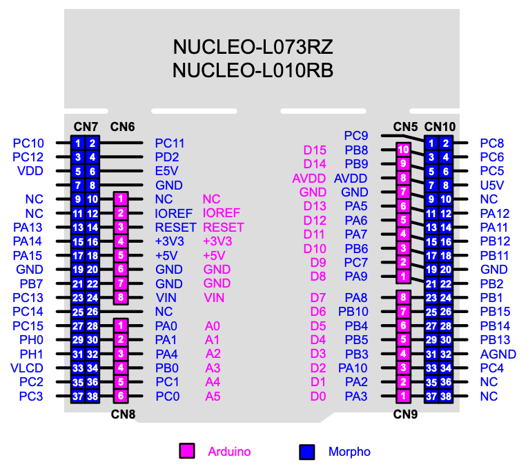

# hello-l073

Bare-metal "hello world" for the [NUCLEO-L073RZ](https://www.st.com/en/evaluation-tools/nucleo-l073rz.html)
(STM32L073RZ, Cortex-M0+). No HAL — registers are accessed directly through the
CMSIS device header.

On reset it:

1. Switches the system clock from the 2.1 MHz MSI to the 16 MHz HSI and starts a 1 ms SysTick.
2. Blinks LD2 (PA5) every 500 ms.
3. Prints a counter over USART2 (PA2/PA3), which is routed to the ST-LINK virtual COM port:

   ```
   L073RZ bare-metal up
   tick 0
   tick 1
   ...
   ```

## Pinout



From UM1724. Pins used by this project: PA5 (LD2, Arduino D13), PA2/PA3 (USART2 TX/RX, Arduino D1/D0).
By default PA2/PA3 are connected to the ST-LINK virtual COM port rather than the Arduino headers (see the USART communication section of UM1724 for the solder bridges that change this).

### Arduino connectors

From UM1724, Table 18.

| Connector | Pin | Pin name | STM32 pin | Function |
| --- | --- | --- | --- | --- |
| **Left connectors** | | | | |
| CN6 power | 1 | NC | - | - |
| CN6 power | 2 | IOREF | - | 3.3V Ref |
| CN6 power | 3 | RESET | NRST | RESET |
| CN6 power | 4 | +3.3V | - | 3.3V input/output |
| CN6 power | 5 | +5V | - | 5V output |
| CN6 power | 6 | GND | - | ground |
| CN6 power | 7 | GND | - | ground |
| CN6 power | 8 | VIN | - | Power input |
| CN8 analog | 1 | A0 | PA0 | ADC_IN0 |
| CN8 analog | 2 | A1 | PA1 | ADC_IN1 |
| CN8 analog | 3 | A2 | PA4 | ADC_IN4 |
| CN8 analog | 4 | A3 | PB0 | ADC_IN8 |
| CN8 analog | 5 | A4 | PC1 or PB9¹ | ADC_IN11 (PC1) or I2C1_SDA (PB9) |
| CN8 analog | 6 | A5 | PC0 or PB8¹ | ADC_IN10 (PC0) or I2C1_SCL (PB8) |
| **Right connectors** | | | | |
| CN5 digital | 10 | D15 | PB8 | I2C1_SCL |
| CN5 digital | 9 | D14 | PB9 | I2C1_SDA |
| CN5 digital | 8 | AREF | - | AVDD |
| CN5 digital | 7 | GND | - | ground |
| CN5 digital | 6 | D13 | PA5 | SPI1_SCK |
| CN5 digital | 5 | D12 | PA6 | SPI1_MISO |
| CN5 digital | 4 | D11 | PA7 | TIM22_CH2 or SPI1_MOSI |
| CN5 digital | 3 | D10 | PB6 | SPI1_CS |
| CN5 digital | 2 | D9 | PC7 | TIM3_CH2 |
| CN5 digital | 1 | D8 | PA9 | - |
| CN9 digital | 8 | D7 | PA8 | - |
| CN9 digital | 7 | D6 | PB10 | TIM2_CH3 |
| CN9 digital | 6 | D5 | PB4 | TIM3_CH1 |
| CN9 digital | 5 | D4 | PB5 | - |
| CN9 digital | 4 | D3 | PB3 | TIM2_CH2 |
| CN9 digital | 3 | D2 | PA10 | - |
| CN9 digital | 2 | D1 | PA2 | USART2_TX |
| CN9 digital | 1 | D0 | PA3 | USART2_RX |

¹ Selected by solder bridges; see UM1724, Table 10: Solder bridges.

### ST morpho connectors

From UM1724, Table 30.

| CN7 odd pin | Name | Name | CN7 even pin | CN10 odd pin | Name | Name | CN10 even pin |
| --- | --- | --- | --- | --- | --- | --- | --- |
| 1 | PC10 | PC11 | 2 | 1 | PC9 | PC8 | 2 |
| 3 | PC12 | PD2 | 4 | 3 | PB8 | PC6 | 4 |
| 5 | VDD | E5V | 6 | 5 | PB9 | PC5 | 6 |
| 7 | BOOT0¹ | GND | 8 | 7 | AVDD | U5V² | 8 |
| 9 | - | - | 10 | 9 | GND | - | 10 |
| 11 | - | IOREF | 12 | 11 | PA5 | PA12 | 12 |
| 13 | PA13³ | RESET | 14 | 13 | PA6 | PA11 | 14 |
| 15 | PA14³ | +3.3V | 16 | 15 | PA7 | PB12 | 16 |
| 17 | PA15 | +5V | 18 | 17 | PB6 | PB11 | 18 |
| 19 | GND | GND | 20 | 19 | PC7 | GND | 20 |
| 21 | PB7 | GND | 22 | 21 | PA9 | PB2 | 22 |
| 23 | PC13 | VIN | 24 | 23 | PA8 | PB1 | 24 |
| 25 | PC14 | - | 26 | 25 | PB10 | PB15 | 26 |
| 27 | PC15 | PA0 | 28 | 27 | PB4 | PB14 | 28 |
| 29 | PH0 | PA1 | 30 | 29 | PB5 | PB13 | 30 |
| 31 | PH1 | PA4 | 32 | 31 | PB3 | AGND | 32 |
| 33 | VLCD | PB0 | 34 | 33 | PA10 | PC4 | 34 |
| 35 | PC2 | PC1 or PB9⁴ | 36 | 35 | PA2 | - | 36 |
| 37 | PC3 | PC0 or PB8⁴ | 38 | 37 | PA3 | - | 38 |

1. The default state of BOOT0 is LOW. It can be set to HIGH when a jumper is on pin 5-7 of CN7. Two unused jumpers are available on CN11 and CN12 (bottom side of the board).
2. U5V is 5 V power from the ST-LINK/V2-1 USB connector and it rises before +5V.
3. PA13 and PA14 share with SWD signals connected to ST-LINK/V2-1; it is not recommended to use them as IO pins if the ST-LINK part is not cut.
4. Refer to UM1724, Table 10: Solder bridges.

## Requirements

- [xPack Arm GNU toolchain](https://xpack-dev-tools.github.io/arm-none-eabi-gcc-xpack/) (`arm-none-eabi-gcc`)
- [xPack OpenOCD](https://xpack-dev-tools.github.io/openocd-xpack/)
- GNU make
- VS Code with [STM32 for VS Code](https://marketplace.visualstudio.com/items?itemName=bmd.stm32-for-vscode)
  and [Cortex-Debug](https://marketplace.visualstudio.com/items?itemName=marus25.cortex-debug) (optional, for building and debugging from the editor)

Toolchain and OpenOCD paths are set in `.stm32env`; edit them to match your machine.

## Build

```sh
make -f STM32Make.make -j
```

Output goes to `build/debug/`: `hello-l073.elf`, `.hex`, `.bin`, and a `.lss` disassembly listing.
Pass `OPTIMIZATION=Os` (or similar) to change the optimization level from the default `-Og`.

In VS Code, the default build task (**Build STM**) runs the same makefile.

## Flash and debug

Connect the board over the ST-LINK USB port, then:

```sh
make -f STM32Make.make flash   # program, verify, reset
make -f STM32Make.make erase   # mass-erase flash
make -f STM32Make.make clean   # delete build/
```

For debugging, use the **Debug STM32** (launch) or **Attach STM32** configurations in VS Code.

## Serial output

The virtual COM port runs at 115200 baud, 8N1:

```sh
screen /dev/tty.usbmodem* 115200
```

## Layout

| Path | Contents |
| --- | --- |
| `src/main.c` | Application |
| `cmsis/` | CMSIS core headers, STM32L0 device header, startup code, and `system_stm32l0xx.c` |
| `STM32L073RZTX_FLASH.ld` | Linker script (192 KB flash, 20 KB RAM) |
| `STM32Make.make` | Makefile generated by STM32 for VS Code — change settings in `STM32-for-VSCode.config.yaml` instead of editing it |
| `openocd.cfg` | OpenOCD interface/target config used by `flash`, `erase`, and the debugger |
| `compile_flags.txt` | Compiler flags for clangd |
| `etc/` | Reference documents (see below) |

## Reference documents

| File | Description |
| --- | --- |
| [`etc/DB_nucleo-l073rz.pdf`](etc/DB_nucleo-l073rz.pdf) | NUCLEO-L073RZ data brief |
| [`etc/um1724-stm32-nucleo64-boards-mb1136-stmicroelectronics.pdf`](etc/um1724-stm32-nucleo64-boards-mb1136-stmicroelectronics.pdf) | UM1724: STM32 Nucleo-64 boards (MB1136) user manual — pinouts, jumpers, solder bridges |
| [`etc/tn1235-overview-of-stlink-derivatives-stmicroelectronics.pdf`](etc/tn1235-overview-of-stlink-derivatives-stmicroelectronics.pdf) | TN1235: overview of ST-LINK derivatives |
| [`etc/nucleo-l073rz-pinout.png`](etc/nucleo-l073rz-pinout.png) | Arduino (CN5/6/8/9) and Morpho (CN7/10) header pinout |
| [`etc/stm32_eval-tools_portfolio.pdf`](etc/stm32_eval-tools_portfolio.pdf) | STM32 evaluation tools portfolio |
