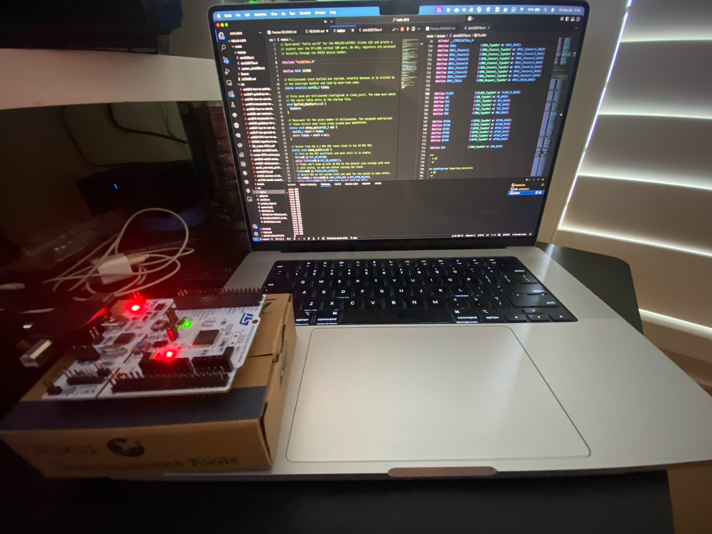

# hello-l073

Bare-metal "hello world" for the [NUCLEO-L073RZ](https://www.st.com/en/evaluation-tools/nucleo-l073rz.html)
(STM32L073RZ, Cortex-M0+). No HAL — registers are accessed directly through the
CMSIS device header.



On boot-up it:

1. Switches the system clock from the 2.1 MHz MSI to the 16 MHz HSI and starts a 1 ms SysTick.
2. Blinks LD2 (PA5) every 500 ms.
3. Prints a counter and the supply voltage over USART2 (PA2/PA3), which is routed to the ST-LINK virtual COM port:

   ```
   L073RZ bare-metal up
   tick 0 vdd 3298 mV raw 1520
   tick 1 vdd 3300 mV raw 1519
   ...
   ```

4. Restarts the counter from 0 when the user button B1 (PC13) is pressed, printing `reset`.

The supply voltage is measured with the ADC against the internal reference (VREFINT, channel 17):
`VDD = 3000 mV × VREFINT_CAL / reading`, where `VREFINT_CAL` is the factory reading taken at 3.0 V, stored at `0x1FF80078`.
Strictly this is VDDA, which the Nucleo ties to VDD. Expect about 3300 mV, within ±1–2%.

## Requirements

- [xPack Arm GNU toolchain](https://xpack-dev-tools.github.io/arm-none-eabi-gcc-xpack/) (`arm-none-eabi-gcc`)
- [xPack OpenOCD](https://xpack-dev-tools.github.io/openocd-xpack/)
- GNU make
- VS Code with [STM32 for VS Code](https://marketplace.visualstudio.com/items?itemName=bmd.stm32-for-vscode)
  and [Cortex-Debug](https://marketplace.visualstudio.com/items?itemName=marus25.cortex-debug) (optional, for building and debugging from the editor)

Toolchain and OpenOCD paths are set in `.stm32env`; edit them to match your machine.

## Build

```sh
make -f STM32Make.make -j
```

Output goes to `build/debug/`: `hello-l073.elf`, `.hex`, `.bin`, and a `.lss` disassembly listing.
Pass `OPTIMIZATION=Os` (or similar) to change the optimization level from the default `-Og`.

In VS Code, the default build task (**Build STM**) runs the same makefile.

## Flash and debug

Connect the board over the ST-LINK USB port, then:

```sh
make -f STM32Make.make flash   # program, verify, reset
make -f STM32Make.make erase   # mass-erase flash
make -f STM32Make.make clean   # delete build/
```

For debugging, use the **Debug STM32** (launch) or **Attach STM32** configurations in VS Code.

- **Live Watch** is enabled in both configurations. Add `loop_count`, `ticks`, or `reset_requested` in the Live Watch panel to see them update while the CPU runs, without halting it. Only globals and statics can be live-watched.
- The Cortex-M0+ has only **4 hardware breakpoints**, and code in flash can't use software breakpoints. Keep at most 3 enabled so stepping has one spare; otherwise GDB fails with `Cannot insert hardware breakpoint ... Remote failure reply: 0E`.

## Serial output

The virtual COM port runs at 115200 baud, 8N1:

```sh
screen /dev/tty.usbmodem* 115200
```

## Layout

| Path | Contents |
| --- | --- |
| `src/main.c` | Application |
| `cmsis/` | CMSIS core headers, STM32L0 device header, startup code, and `system_stm32l0xx.c` |
| `STM32L073RZTX_FLASH.ld` | Linker script (192 KB flash, 20 KB RAM) |
| `STM32Make.make` | Makefile generated by STM32 for VS Code — change settings in `STM32-for-VSCode.config.yaml` instead of editing it |
| `openocd.cfg` | OpenOCD interface/target config used by `flash`, `erase`, and the debugger |
| `compile_flags.txt` | Compiler flags for clangd |
| `etc/` | Reference documents (see below) |

## Reference documents

### STM32L073RZ

| File | Description |
| --- | --- |
| [`etc/stm32l073rz.pdf`](etc/stm32l073rz.pdf) | Datasheet — pinout, alternate functions, electrical characteristics |
| [`etc/rm0367-ultralowpower-stm32l0x3-advanced-armbased-32bit-mcus-stmicroelectronics.pdf`](etc/rm0367-ultralowpower-stm32l0x3-advanced-armbased-32bit-mcus-stmicroelectronics.pdf) | RM0367: STM32L0x3 reference manual — peripheral registers |
| [`etc/pm0223-stm32-cortexm0-mcus-programming-manual-stmicroelectronics.pdf`](etc/pm0223-stm32-cortexm0-mcus-programming-manual-stmicroelectronics.pdf) | PM0223: Cortex-M0+ programming manual — core, instruction set, SysTick, NVIC |
| [`etc/es0292-stm32l07xxxl08xxx-device-errata-stmicroelectronics.pdf`](etc/es0292-stm32l07xxxl08xxx-device-errata-stmicroelectronics.pdf) | ES0292: STM32L07x/L08x errata |

### Board and tools

| File | Description |
| --- | --- |
| [`etc/DB_nucleo-l073rz.pdf`](etc/DB_nucleo-l073rz.pdf) | NUCLEO-L073RZ data brief |
| [`etc/um1724-stm32-nucleo64-boards-mb1136-stmicroelectronics.pdf`](etc/um1724-stm32-nucleo64-boards-mb1136-stmicroelectronics.pdf) | UM1724: STM32 Nucleo-64 boards (MB1136) user manual — pinouts, jumpers, solder bridges |
| [`etc/tn1235-overview-of-stlink-derivatives-stmicroelectronics.pdf`](etc/tn1235-overview-of-stlink-derivatives-stmicroelectronics.pdf) | TN1235: overview of ST-LINK derivatives |
| [`etc/nucleo-l073rz-pinout.png`](etc/nucleo-l073rz-pinout.png) | Arduino (CN5/6/8/9) and Morpho (CN7/10) header pinout |
| [`etc/stm32_eval-tools_portfolio.pdf`](etc/stm32_eval-tools_portfolio.pdf) | STM32 evaluation tools portfolio |

## Reference links

| Link | Description |
| --- | --- |
| [STM32L073RZ product page](https://www.st.com/en/microcontrollers-microprocessors/stm32l073rz.html) | ST's page for the MCU — datasheet, reference manual, errata, application notes, and tools |
| [ARM-software/CMSIS-DSP](https://github.com/ARM-software/CMSIS-DSP) | Arm's DSP library (filters, FFT, matrix, statistics) with fixed-point `q7`/`q15`/`q31` kernels, which suit the FPU-less Cortex-M0+. |
| [ARM-software/optimized-routines](https://github.com/ARM-software/optimized-routines) | Arm's reference implementations of libm math functions and string/memory routines, mainly for AArch64 and AArch32; C libraries such as newlib and glibc carry versions of them. |
